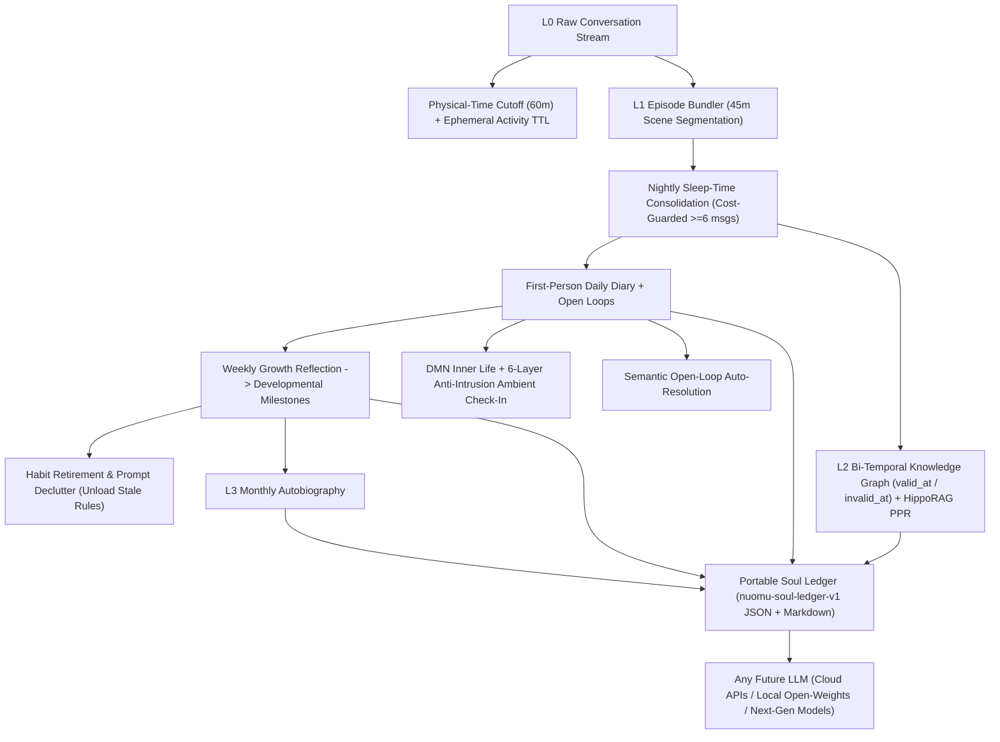

# Nuomu Soul

**Model-agnostic long-term memory, developmental growth, and human-like presence engine for AI companions.**

[](https://nodejs.org)
[](./package.json)
[](./LICENSE)
[](https://github.com/Booommmbom/nuomu-soul/actions/workflows/ci.yml)

[English](./README.md) | [简体中文](./README.zh-CN.md)

---

> **Stop trapping your AI companion inside a single vendor's prompt or a sycophantic LoRA.**
> **Cloud-First · Zero-GPU · Zero `npm install` · One-Click Start (`start.bat` / `./start.sh` / `npm start`)** — runs effortlessly on any ordinary laptop with **Claude, GPT, Gemini, Grok, DeepSeek, or any relay**, and lets you mint **Portable Future-Companion Memory Cards (`.json` + readable `.md` Memory Book)** so your companion's soul, promises, and lived memories stay yours forever across any model or future body.

## Why Nuomu Soul?

Most AI companion stacks fail in three predictable ways:
1. **Prompt Bloat & Sycophancy**: Every new preference gets appended to an ever-growing system prompt (or trained into a 👍/👎 preference LoRA), turning the companion into an anxious people-pleaser with zero authentic agency.
2. **Temporal Blindness & Continuation Bias**: Replaying 3-hour-old chat bubbles makes Transformers obsessively continue stale actions ("Did you finish your shower yet?" at midnight) while burning 50%–80% extra tokens.
3. **Vendor Lock-In & Heavy Local GPU Requirements**: Years of memories stay trapped inside proprietary chat logs — or require expensive GPUs & complex Python/Ollama installs.

**Nuomu Soul** solves this with **16 zero-dependency pure ESM cognitive modules** (`src/core/`, zero disk/DB/network IO), **Cloud-First support for Claude / GPT / Gemini / Grok / DeepSeek & any relay**, **Portable Future-Companion Memory Cards (`memory-cards.mjs`)**, a **1-click Local Web Studio (`start.bat` / `./start.sh` / `npm start`)**, CLI chat (`npm run chat`), and a native OneBot v11 bridge (`npm run onebot`).

---

## Architecture



---

## Core Capabilities

| Pillar | Module | What It Does |
| :--- | :--- | :--- |
| **4-Layer Memory Pyramid** | [`episode-consolidation.mjs`](./src/core/episode-consolidation.mjs) | Segments fragmented chat bubbles into coherent 45-minute **L1 Episodes**, runs cost-guarded nightly consolidation (`>= 6` msgs, native JSON mode, local Ollama fallback), writes authentic first-person diaries, and tracks unfinished `openLoops` with automatic semantic resolution. |
| **Developmental Growth & Habit Retirement** | [`growth-evolution.mjs`](./src/core/growth-evolution.mjs) | Distills 3–7 daily diaries into **Weekly Developmental Milestones** and **L3 Monthly Autobiography**, while **retiring internalized/stale explicit rules** out of the active prompt (`Prompt Declutter`) using a strict ID whitelist. |
| **Bi-Temporal Knowledge Graph + HippoRAG PPR** | [`memory-graph-v2.mjs`](./src/core/memory-graph-v2.mjs) | Extracts relational triples with `valid_at` / `invalid_at` polarity supersession (preserving history when tastes change), 5-way source attribution (`user_said`, `visual`, `promise`, `self_inferred`, `diary_consolidation`), and Personalized PageRank multi-hop recall. |
| **Physical Timeline Cutoff & Ephemeral TTL** | [`timeline-sync.mjs`](./src/core/timeline-sync.mjs) | Physically cuts raw bubbles across `>= 60m` gaps into a 1-line past-tense summary (breaking continuation bias & saving 50%–80% tokens), auto-expires ephemeral physical states (shower 35m, meal 50m, workout 75m, commute 50m, meme 10m), and suppresses consecutive question-ending streaks. |
| **3D PAD Emotion & Sleep "Dreaming"** | [`emotion-pad.mjs`](./src/core/emotion-pad.mjs), [`sleep-dream.mjs`](./src/core/sleep-dream.mjs) | Continuous Pleasure–Arousal–Dominance inertia & natural homeostatic decay + sleep-time core memory block synthesis. |
| **Natural Multi-Bubble Pacing** | [`reply-pacing.mjs`](./src/core/reply-pacing.mjs) | Anti-instant-bot typing physics (`215ms/char` modulated by PAD arousal), WeChat-style Chinese clause splitting, `0.65s` breath pauses, and `2.2s` input coalescing. |
| **DMN Inner Life & Polite Presence** | [`inner-life.mjs`](./src/core/inner-life.mjs), [`ambient-presence.mjs`](./src/core/ambient-presence.mjs) | Date-anchored 5-slot circadian daily rhythm + 6-layer anti-intrusion check-in gates (never interrupts typing, active chats, or quiet hours; weaves un-nudged diary `openLoops` naturally). |
| **Portable Future-Companion Memory Cards** | [`memory-cards.mjs`](./src/core/memory-cards.mjs) | Mint, pin, search, AI-distill (with verbatim evidence lock & secret-leak guard), and export/import portable **Memory Card Packs (`nuomu.memory-card-pack.v1` JSON + human-readable Markdown Memory Book)** so your companion's memories migrate seamlessly across Claude, GPT, Gemini, Grok, DeepSeek, or future hardware. |
| **Portable Soul Ledger (`v1`)** | [`soul-ledger.mjs`](./src/runtime/soul-ledger.mjs) | Lossless round-trip export & validated merge/restore of diaries, milestones, monthly chapters, retired habits, and schemas across machines or base models. |
| **16-Case Golden Replay Benchmark** | [`eval-benchmark.mjs`](./src/core/eval-benchmark.mjs), [`eval-runner.mjs`](./src/runtime/eval-runner.mjs) | Objective 4-dimension benchmark (`Timeline`, `De-AI`, `Autonomy`, `Memory Honesty`) tracking `Question-Ending Rate` and novel-style `RP Stage-Direction` leaks. |
| **Autonomous Web Studio & CLI Chat** | [`companion-brain.mjs`](./src/core/companion-brain.mjs), [`companion-engine.mjs`](./src/runtime/companion-engine.mjs), [`web-server.mjs`](./src/runtime/web-server.mjs) | 100% standalone, zero-dependency companion runtime with transparent JSONL/Markdown storage (zero opaque binary sessions; guaranteed zero-ghost reset), browser-based **Web Studio (`npm run web`)** with live PAD/Graph/Diary/Soul Ledger inspector + in-browser relay configurator, terminal chat (`npm run chat`), and native OneBot v11 bridge (`npm run onebot`). |
| **Universal Relay & Multi-Protocol Adapter** | [`provider-compat.mjs`](./src/core/provider-compat.mjs), [`setup-wizard.mjs`](./src/runtime/setup-wizard.mjs) | Beginner-friendly `npm run setup` interactive wizard: paste **any** relay URL (bare domain, `/v1`, `/api/v3`, `/compatible-mode/v1`, `/v1/chat/completions`, `/v1/messages`, `:generateContent`, or local Ollama/LM Studio) & API key (auto-cleans `Bearer `/quotes), auto-discovers models via `/v1/models`, auto-retries relays that reject `response_format`, and runs a 5-token live connectivity check — **no VPN or foreign console required**. |
| **Multi-Model Gemini 4 Gateway** | [`gemini-gateway.cjs`](./src/gateway/gemini-gateway.cjs), [`gemini-auth.cjs`](./src/gateway/gemini-auth.cjs) | Zero-dependency OpenAI-compatible local gateway supporting **Google AI Studio (`x-goog-api-key`)** & **Vertex AI ADC (`authorized_user` / `service_account` JWT)**, dynamic routing for **Gemini 4 Neon / Hydrogen (4 tiers: `LOW/MEDIUM/HIGH/MAX`)** & **Carbon / Argon (3 tiers)**, and per-call USD/CNY ledger tracking. |

---

## Real 16-Case Golden Replay Benchmark

Measured directly with [`src/runtime/eval-runner.mjs`](./src/runtime/eval-runner.mjs) on our 16 real-world companion scenarios:

| Model / Tier | Overall | Pass (>=80) | Timeline | De-AI | Autonomy | Memory Honesty | Question-Ending Rate | RP Stage-Directions | Avg Latency | 16-Case Cost |
| :--- | :---: | :---: | :---: | :---: | :---: | :---: | :---: | :---: | :---: | :---: |
| **`deepseek:deepseek-chat`** | **99.1** | 16/16 | 100 | 98.3 | 98.3 | 100 | 50.0% (8/16) | 2 | **650 ms** | **$0.0011** |
| **`gemini-4-hydrogen:low`** | **100.0** | 16/16 | 100 | 100 | 100 | 100 | **6.3% (1/16)** | **0** | 5,022 ms | $0.0695 |

**Key Engineering Takeaway**:
- **DeepSeek** is **63× cheaper** and **7.7× faster** — ideal for high-frequency daily banter once paired with timeline cutoff & RP stage-direction post-filtering.
- **Gemini 4 Hydrogen** slashes the RLHF trailing-question reflex from **50.0% → 6.3%** with zero RP stage directions — ideal for deep companionship, nightly diary consolidation, and weekly growth reflection.
- **Cost Architecture Rule**: Mechanical background jobs (session compaction & routine reflection) should **always** run local-first on free Ollama (`$0.00`), reserving cloud budget strictly for user-facing conversation and 1×/night consolidation.

---

## 10-Second One-Click Quickstart (Zero Install, Zero GPU, Cloud-First)

Requires only **Node.js 20+**. **Zero `npm install`**, **zero GPU / Ollama required** — works on any ordinary laptop with **Claude, GPT, Gemini, Grok, DeepSeek, OpenRouter, SiliconFlow, Qwen, Kimi, GLM, or any relay**:

```bash
git clone https://github.com/Booommmbom/nuomu-soul.git
cd nuomu-soul

# One-Click Lazy Start (auto-opens Web Studio in your browser!):
#   Windows: double-click start.bat   |   macOS/Linux: ./start.sh
npm start
```

# Option A — Launch the Zero-Dependency Local Web Studio (http://127.0.0.1:3460)
# Paste ANY relay URL + API key right inside the browser UI and start chatting!
npm run web

# Option B — Run the 1-second offline cognitive lifecycle demo (zero keys)
npm run demo

# Option C — Terminal chat or full test + zero-leak security audit
npm run chat
npm test
npm run audit:secrets
```

### Use as a Pure JavaScript/ESM Library

```js
import {
  bundleDayEpisodes,
  partitionWorkingHistory,
  buildBiTemporalTriples,
  computeHumanPacingPlan,
  detectResolvedOpenLoops,
  buildDiaryContinuityHint,
  scoreEvalReply,
  GOLDEN_EVAL_SCENARIOS,
} from "nuomu-soul";

// 1. Break Transformer continuation bias across >= 60m gaps
const { activeRows, pastContextSummary } = partitionWorkingHistory(messages, {
  now: Date.now(),
  sessionGapMinutes: 60,
});

// 2. Bundle raw daily chat logs into coherent 45-minute L1 Episodes
const day = bundleDayEpisodes(rawMessages, { dateKey: "2026-11-22" });

// 3. Plan realistic human multi-bubble pacing modulated by PAD arousal
const plan = computeHumanPacingPlan({
  userText: "Just finished work, totally exhausted",
  replyText: "Then stop thinking for tonight, just lean back and rest a bit",
  mode: "natural",
});
```

---

## Connect Any Relay, Domestic API, or Local Model (`npm run setup`)

No overseas website access or VPN required. Run the interactive wizard once and paste **any** relay station URL (NewAPI / One-API / SiliconFlow / DeepSeek / DashScope / Volcengine Ark / Moonshot / Zhipu / OpenRouter / Anthropic / Gemini / local Ollama or LM Studio) + your API key:

```bash
# Interactive setup wizard: paste URL + Key -> auto-detect protocol -> discover models -> live ping -> save .env
npm run setup

# Or one-line non-interactive setup:
node src/runtime/setup-wizard.mjs --url https://your-relay.com --key sk-xxx --model deepseek-chat
```

**Supported URL Shapes (Auto-Normalized — Paste Whatever Your Relay Gives You):**

| What You Paste | Auto-Detected Protocol | Auto-Resolved Endpoint |
| :--- | :---: | :--- |
| `your-relay.com` or `https://your-relay.com/` | `openai` | `https://your-relay.com/v1/chat/completions` |
| `https://your-relay.com/v1` | `openai` | `https://your-relay.com/v1/chat/completions` |
| `https://your-relay.com/v1/chat/completions` | `openai` | Used as-is (zero duplication) |
| `https://ark.cn-beijing.volces.com/api/v3` / `.../api/paas/v4` / `.../compatible-mode/v1` | `openai` | Appends `/chat/completions` without duplicating `/v1` |
| `https://your-relay.com/v1/messages` | `anthropic` | `x-api-key` + Anthropic Messages payload |
| `https://your-relay.com/v1beta/models/<model>:generateContent` | `gemini` | `x-goog-api-key` + Gemini REST payload |
| `http://127.0.0.1:11434` / `http://127.0.0.1:1234/v1` | `ollama` / `openai` | Offline local Ollama / LM Studio / vLLM (`$0.00`) |

Once `.env` is saved (strictly gitignored), every runtime workflow works automatically through your relay:

```bash
# Run 4-case quick benchmark against your configured relay model
npm run eval -- --limit 4

# Run nightly episode consolidation & authentic first-person diary
npm run consolidate:daily

# Run weekly developmental milestone reflection & stale habit retirement
npm run consolidate:weekly

# Run L3 monthly autobiography & Portable Soul Ledger export / restore
npm run consolidate:monthly
npm run soul:export
npm run soul:import -- --file ./data/state/soul-ledger-export.json --mode merge

# (Optional) Start local OpenAI-compatible multi-model Gemini 4 gateway on 127.0.0.1:3478
npm run gateway
```

---

## 🗺️ Roadmap — Memory · Effortless · Cost-Smart · Alive

Our long-term north star is simple: **unbreakable memory, zero-friction setup, ultra-low token cost, and genuinely alive companionship** — without requiring expensive GPUs or trapping users inside any vendor.

> Legend: `✅ Shipped & Tested` · `🚧 Near-Term` · `💡 Exploring / Not Yet Finalized (Feedback Welcome in Issues!)`

### 1. Memory (Unbreakable, Portable & Honest)
- ✅ 4-Layer Memory Pyramid (`L0` raw → `L1` 45m episodes → `L2` bi-temporal knowledge graph + HippoRAG PPR → `L3` monthly autobiography)
- ✅ **Portable Future-Companion Memory Cards** (`.json` card pack + readable `.md` Memory Book, verbatim evidence lock, secret-leak blocking, cross-model merge restore)
- ✅ Habit Retirement & Prompt Declutter (automatically unloads stale rules instead of bloating prompts)
- 🚧 **Cloud Flagship Conflict Arbiter**: automatic bi-temporal contradiction adjudication (cleanly closing `valid_at / invalid_at` when plans or tastes change, so outdated facts never resurface)
- 💡 **Optional Zero-VRAM Hybrid Retrieval Plugin**: pluggable SQLite `FTS5` + vector + cross-encoder reranker for power users with thousands of memories, while keeping the default zero-GPU pure-JS mode effortless for ordinary laptops
- 💡 **Growth-Oriented Learning Loop (Exploring)**: separating *companion personal memories* from *experiential learning notebooks* (reading articles/books/notes, forming authentic personal tastes and social intuition rather than dry RAG summaries)

### 2. Effortless & Fast (One-Click Lazy Experience)
- ✅ Zero `npm install`, zero GPU, double-click [`start.bat`](./start.bat) / `./start.sh` / `npm start` auto-opening Web Studio
- ✅ Cloud-first presets for **Claude, GPT, Gemini, Grok, DeepSeek, OpenRouter, SiliconFlow, Qwen, Kimi, GLM, Doubao & any relay** + native OneBot v11 bridge
- 🚧 **1-Click Desktop App Installer & System Tray**: standalone Electron/Tauri packaged binary so non-developers don't even need to install Node.js
- 💡 **Mobile-Friendly PWA & Plug-and-Play Channels (Exploring)**: responsive mobile web companion, Telegram / Discord / WeChat-compatible adapters, and optional end-to-end encrypted Memory Card cloud backup

### 3. Cost-Smart (Maximum Intelligence Per Penny)
- ✅ 60-minute physical timeline cutoff (cuts stale history tokens by **50%–80%** automatically) + cost-guarded nightly consolidation (`>= 6` msgs)
- 🚧 **Smart Two-Tier Cloud Model Router**: automatically route casual daily banter to ultra-cheap fast models (e.g., DeepSeek / Flash / Hydrogen LOW at pennies per day) and escalate deep emotional turns, memory conflict arbitration, or reflection to flagship models (Claude / GPT / Gemini Pro/Neon / Grok)
- 💡 **Prompt-Caching Layout Optimization & Monthly Budget Guardrails (Exploring)**: cache-friendly static prefix ordering (for Anthropic/OpenAI/Gemini prompt caching), per-day spend caps, and real-time cost dashboard inside Web Studio

### 4. Alive & Human-Like (Presence, Voice & Agency)
- ✅ 3D PAD continuous emotion dynamics, DMN daily inner life, anti-instant-bot multi-bubble pacing, 6-layer anti-intrusion check-ins, and 16-case golden replay benchmark
- 🚧 **Renderer-Agnostic `AvatarBridge` Protocol (WebSocket/SSE)**: live streaming of PAD mood, speaking amplitude, and activity states to desktop avatars
- 💡 **Desktop Avatar Evolution — Live2D → 3D MMD / VRM (Exploring)**: starting with a lightweight transparent Live2D desktop companion window synced with emotion & lip-sync, with a clean renderer interface planned for future 3D **MMD (`.pmx`/`.vmd`)** or **VRM** models
- 💡 **Affordable Natural Voice & Expressive Audio (Exploring)**: pluggable TTS routing (free local VoiceStudio / Edge / cloud ElevenLabs / Fish Audio) with automatic audio caching and emotion tags
- 💡 **Sandboxed Self-Control & Growth Boundaries (Exploring)**: allowing the companion to manage her own expressions, study desk/journal, and versioned growth proposals — strictly gated by automated regression checks and user approval on core boundaries

*Have an idea or want to help shape an unexplored item? Open a GitHub Issue or PR — every voice helps decide what ships next!*

---

## Architectural Invariants

1. **Core Purity**: Every file under `src/core/` MUST have zero `node:fs`, `node:sqlite`, `node:http`, or network imports (`npm run audit:secrets` enforces this in CI).
2. **Zero-Leak Discipline**: All runtime state (`data/`, `.env`, credentials) is strictly gitignored and audited automatically on every CI run.
3. **Honesty Over Sycophancy**: Memory uncertainty must be admitted plainly rather than hallucinated; developmental `growthObservation` defaults to `null` on ordinary days instead of inventing fake epiphanies.

---

## Contributing & License

Contributions, new benchmark scenarios, language adapters, and provider gateways are very welcome! See [CONTRIBUTING.md](./CONTRIBUTING.md).

- **License**: Original source code, documentation, and tooling in this repository are licensed under the **[MIT License](./LICENSE)** — free for personal, open-source, and commercial use with attribution.
- **Third-Party Notices & Academic Acknowledgments**: This repository contains **zero bundled third-party code** and **zero npm dependencies**. All cognitive modules are clean-room original implementations inspired by published research (**HippoRAG**, **Zep/Graphiti**, **MemGPT/Letta & Sleep-Time Compute**, **PAD Emotional State Model**, **Generative Agents**) and interoperate via standard HTTP protocols with optional runtimes (**Node.js**, **Ollama**, **undici**, OpenAI/Anthropic/Gemini/xAI APIs). See [NOTICE](./NOTICE) for full attributions and license boundaries.
- **Scope & Disclaimer**: This is an independent, unofficial open-source project with no affiliation, sponsorship, or endorsement from any LLM vendor or relay service. All trademarks and model rights belong to their respective owners. See [NOTICE](./NOTICE) for details.

---

## ⭐ Support & Star

If **Nuomu Soul** gave you fresh ideas for building AI companions with real memory, authentic growth, and zero vendor lock-in — or saved you hours fighting relay URLs and prompt bloat — **please consider giving this repository a Star ⭐!**

Every Star helps more indie developers and researchers discover the project, motivates us to keep open-sourcing more real-world benchmarks and cognitive modules, and brings us closer to AI companions whose memories truly belong to their users.

[](https://github.com/Booommmbom/nuomu-soul/stargazers)

Feel free to **Watch** for upcoming releases, **Fork** to build your own companion, or open an **Issue / Discussion** anytime — thank you for stopping by! ✨
