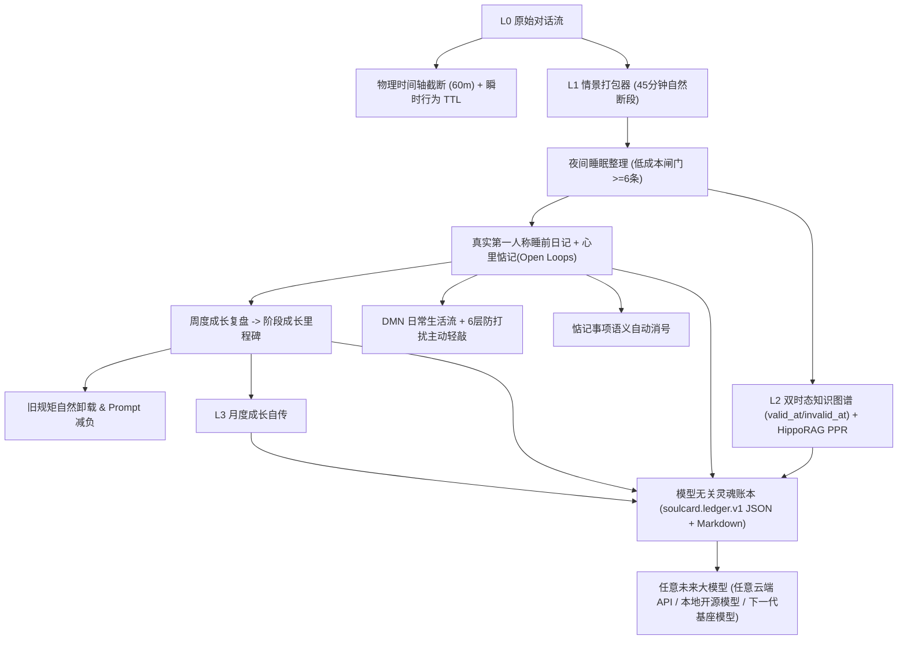

# SoulCard（AI 伴侣灵魂记忆卡引擎）

**与底层模型无关的 AI 伴侣长期记忆、成长演化与类人交互核心引擎。**

[](https://nodejs.org)
[](./package.json)
[](./LICENSE)
[](https://github.com/Booommmbom/soulcard/actions/workflows/ci.yml)

[English](./README.md) | [简体中文](./README.zh-CN.md)

---

> **不要把你的 AI 伴侣锁死在某一家大模型的 Prompt 或讨好型 LoRA 里。**
> **纯云端零显卡 · 零 `npm install` · 双击一键懒人启动（`start.bat` / `./start.sh` / `npm start`）**——普通轻薄本直接畅连 **Claude / GPT / Gemini / Grok / DeepSeek / 任意中转站**；内置 **「未来伴侣记忆卡（Memory Card）」** 与 **灵魂账本**，把你和 TA 的珍贵记忆、偏好与约定存成可携带的 `.json` 存卡与人类可读 `.md` 记忆卡册，换模型、换电脑、乃至未来换任何实体，插卡即复活！

## 为什么做 SoulCard？

市面上绝大多数 AI 伴侣工程都会撞上三堵墙：
1. **Prompt 无限膨胀与讨好退化**：每学一条偏好就往系统提示词里塞一条规矩（或者拿用户的 👍/👎 喂讨好型 LoRA），最后变成小心翼翼的客服，丧失独立性格与边界。
2. **时间轴错乱与续写惯性**：隔了 3 小时再聊，Transformer 仍对着旧历史气泡强行续写（「水放了没？洗完澡没？」），既出戏又白烧 50%–80% 无效上下文 Token。
3. **门槛太高 & 厂商绑死**：动辄要求高配显卡装本地模型、装一堆 Python 依赖，或者换一家大模型就把几年的共同回忆全丢了。

**SoulCard** 提供 **17 个零依赖纯 ESM 认知核心模块**（`src/core/`，零磁盘/数据库/网络 IO）、**全云端模型即开即用（Claude / GPT / Gemini / Grok / DeepSeek / 各类国内免梯中转站）**、**未来伴侣记忆卡系统（`memory-cards.mjs`）**、**体验学习与社交体感成长闭环（`growth-learning.mjs`）**、**双击即用的本地 Web Studio（`start.bat` / `./start.sh` / `npm start`）**、终端实聊（`npm run chat`）以及原生 OneBot v11 桥接（`npm run onebot`），**无需显卡、无需 `npm install`**。

---

## 核心架构



---

## 九大核心能力

0. **未来伴侣记忆卡（`memory-cards.mjs`）**：把 TA 的偏好、共同约定、珍贵瞬间与灵感手账存成一张张可置顶、可搜索的「记忆卡」；支持手动写卡或 **AI 一键从对话提炼（自带原文逐字证据锁 + 密钥防泄露拦截）**；一键导出跨模型 `.json` 记忆存卡包与人类可读《记忆卡册.md》，换 Claude / GPT / Gemini / Grok / DeepSeek 或未来新设备，插卡无损合并恢复！
1. **四层模型无关记忆金字塔（`episode-consolidation.mjs`）**：按 45 分钟自然断段把碎片聊天打包成 L1 情景段；每日低成本睡眠整理（`< 6` 条自动跳过，原生 JSON 输出，离线自动降级本地 Ollama），产出真实第一人称日记、带原文依据的双时态事实、以及带自然过期 TTL 的「心里惦记（`openLoops`）」。
2. **成长演化与旧规矩自然卸载（`growth-evolution.mjs`）**：周度复盘把多日日记升华为阶段里程碑，同时按严格白名单把已内化的刻板旧规矩移出活跃 Prompt（归档保留历史），彻底避免 Prompt 越用越臃肿；支持每月沉淀 L3 月度自传。
3. **双时态知识图谱 + HippoRAG PPR（`memory-graph-v2.mjs`）**：当用户口味或习惯改变时保留历史脉络（`valid_at` / `invalid_at` 极性覆盖），支持 5 类记忆来源归因与多跳联想召回。
4. **物理时间轴截断 + 瞬时行为 TTL（`timeline-sync.mjs`）**：跨 `>= 60` 分钟未聊自动切出陈旧历史气泡压成 1 句过去时背景（直省 50%–80% Token），洗澡/吃饭/健身/通勤/表情包超期自动归档，并抑制闭源模型连续句尾反问习惯。
5. **3D PAD 连续情绪动力学 + 睡眠期做梦整理（`emotion-pad.mjs` / `sleep-dream.mjs`）**：愉悦度–唤醒度–支配度连续情绪惯性与稳态回落。
6. **反秒回拟人多气泡节律（`reply-pacing.mjs`）**：基于真实中文敲字速度（`215ms/字`）与 PAD 唤醒度调制的阅读停顿、微信体逗号自然断泡、`0.65s` 泡间呼吸间隙与 `2.2s` 连发防抢答合并窗。
7. **内生生活流 DMN + 6 层防打扰轻敲 + 惦记自动消号（`inner-life.mjs` / `ambient-presence.mjs`）**：绝不打断打字、活跃聊天与深夜睡眠，把未轻敲的日记惦记自然揉进问候，聊完后自动语义消号不翻旧账。
8. **16 题真实黄金回放评测 + 多模型 Gemini 4 网关（`eval-benchmark.mjs` / `gemini-gateway.cjs`）**：客观量化时间轴、去 AI 味、自主边界、记忆诚实性、句尾反问率与 RP 括号旁白；网关同时支持 Google AI Studio 与 Vertex AI ADC（绕过企业组织禁用静态 API Key 限制），动态路由 Neon/Hydrogen（4 档）与 Carbon/Argon（3 档）并按美元/人民币逐笔透明记账。

---

## 16 题真实黄金回放实测数据

使用 [`src/runtime/eval-runner.mjs`](./src/runtime/eval-runner.mjs) 实跑对比结果：

| 模型 / 档位 | 综合总分 | 通过(>=80) | 时间轴 | 去AI味 | 自主边界 | 记忆诚实 | **句尾反问率** | **RP括号旁白** | 平均耗时 | 16 题实耗 |
| :--- | :---: | :---: | :---: | :---: | :---: | :---: | :---: | :---: | :---: | :---: |
| **`deepseek:deepseek-chat`** | **99.1** | 16/16 | 100 | 98.3 | 98.3 | 100 | 50.0% (8/16) | 2 次 | **650 ms** | **$0.0011 (¥0.008)** |
| **`gemini-4-hydrogen:low`** | **100.0** | 16/16 | 100 | 100 | 100 | 100 | **6.3% (1/16)** | **0 次** | 5,022 ms | $0.0695 (¥0.501) |

---

## 10 秒懒人一键上手（零依赖 · 零显卡 · 全云端开箱即聊）

只需 **Node.js 20+**，**不需要 `npm install`，不需要独立显卡，不需要装 Ollama**：

- **Windows 懒人最省心**：下载仓库后，直接**双击 [`start.bat`](./start.bat)**，自动启动并打开浏览器！
- **macOS / Linux**：终端运行 **`./start.sh`** 或 **`npm start`**！

```bash
git clone https://github.com/Booommmbom/soulcard.git
cd soulcard

# 方式 A（最推荐 · 一键启动并自动打开浏览器）：
# 在页面右上角选 Claude / GPT / Gemini / Grok / DeepSeek / 任意中转站，贴入 Key 10 秒开聊！
# 右侧直接管理「未来伴侣记忆卡」、实时观察 3D PAD 情绪、双时态图谱与成长日记！
npm start

# 方式 B：一秒离线跑通全部认知支柱演示（无需 Key）
npm run demo

# 方式 C：终端实聊 / 跑全量 11 大套单测与安全回归 / 零泄密安全审计
npm run chat
npm test
npm run audit:secrets
```

---

## 新手零门槛接入大模型：支持任意中转站 & 国内直连（无需访问海外官网）

不需要折腾海外账号或代理，只要运行一条命令，按中文提示粘贴你的**中转站网址**和 **API Key** 即可自动配好：

```bash
# 一键交互式配置向导：粘贴中转站网址 + Key -> 自动识别协议 -> 自动拉取模型列表 -> 5-token 连通性自检 -> 写入 .env
npm run setup

# 也支持一行命令行直接写入：
node src/runtime/setup-wizard.mjs --url https://你的中转站网址 --key sk-xxx --model deepseek-chat
```

**多维度兼容市面上几乎所有中转站与接口格式（随便粘，引擎自动补全不报错）：**

| 你粘贴进来的网址格式 | 自动识别协议 | 引擎自动补全后的真实调用地址 |
| :--- | :---: | :--- |
| 裸域名 `api.xxx.com` 或 `https://api.xxx.com/` | `openai` | `https://api.xxx.com/v1/chat/completions` |
| OpenAI 风格 `https://api.xxx.com/v1` | `openai` | `https://api.xxx.com/v1/chat/completions` |
| 完整地址 `https://api.xxx.com/v1/chat/completions` | `openai` | 原样直用，绝不重复拼接 `/v1` |
| 国内大厂直连（DeepSeek / 硅基流动 / 阿里云百炼 `/compatible-mode/v1` / 火山方舟 `/api/v3` / Kimi / 智谱 `/api/paas/v4`） | `openai` | 智能识别版本前缀，免梯直连 |
| Anthropic 原生或中转 `https://xxx/v1/messages` | `anthropic` | 自动转换 `x-api-key` + Messages 格式 |
| Gemini 原生或中转 `.../v1beta/models/<模型>:generateContent` | `gemini` | 自动转换 `x-goog-api-key` + REST 格式 |
| 本地免费离线 `http://127.0.0.1:11434` / `127.0.0.1:1234/v1` | `ollama` / `openai` | Ollama / LM Studio / vLLM 零费用运行 |

- **防呆细节**：API Key 自动清理复制时多带的空格、引号和 `Bearer ` 前缀；遇到老版本中转站不支持 `response_format: json_object` 报 400 时，引擎自动降级重试，不会卡死。
- 配完 `.env` 后，下面所有真实工作流直接开跑：

```bash
npm run eval -- --limit 4      # 用你的中转站模型跑 4 题快速实测
npm run consolidate:daily      # 每日情景打包 + 生成真实第一人称日记
npm run consolidate:weekly     # 周度成长复盘 + 自动卸载旧规矩给 Prompt 减负
npm run consolidate:monthly    # 生成 L3 月度成长自传
npm run soul:export            # 导出可跨模型无损迁移的灵魂账本 v1
```

## 🗺️ Roadmap 发展路线图（核心方向：记忆 · 快捷 · 便宜 · 真实）

我们的长期目标非常聚焦：**不崩不串味的长期记忆、懒人一键上手的极简体验、极致省钱的云端路由、以及真正像活人一样的陪伴感**——不绑死任何厂商，也不要求普通用户买昂贵显卡。

> 状态说明：`✅ 已落地可用` · `🚧 近期推进` · `💡 未来构思 / 细节未敲定（非常欢迎在 Issue 里一起讨论拍板！）`

### 一、记忆（更牢、不串味、可携带）
- ✅ **四层记忆金字塔**（`L0` 原文 → `L1` 45 分钟情景打包 → `L2` 双时态知识图谱 + HippoRAG PPR 联想 → `L3` 月度成长自传）
- ✅ **未来伴侣记忆卡（Memory Cards）**：手动写卡 / AI 带原文证据锁自动提炼 / 一键导出跨模型 `.json` 存卡与人类可读《记忆卡册.md》/ 防 API Key 误存
- ✅ **旧规矩自然卸载（Prompt Declutter）**：随成长淘汰僵硬条款，拒绝 Prompt 越用越臃肿
- 🚧 **云端旗舰冲突终审流**：当你的计划或喜好改变时（例如“不去苏州改去成都”），自动调用云端高智商模型关闭旧事实有效期（`invalid_at`），彻底根治过时记忆串味
- ✅ **成长型体验学习与社交体感复盘闭环**：把「私人记忆卡」与「学习体验随笔」物理分离，分享文章/笔记给 TA 后写出真实第一人称感想与新好奇，并支持一键社交体感复盘与自动淘汰生硬旧规矩（纯云端零显卡）
- 💡 **可选零显存增强检索引擎（构思中）**：默认保持零依赖纯 JS 秒跑（轻薄本无压力），为记忆量上万的重度用户提供可选 `SQLite FTS5 + 向量 + Reranker` 增强插件

### 二、快捷（真·懒人一键开箱）
- ✅ **零 `npm install` · 零显卡 · 一键启动**：Windows 双击 [`start.bat`](./start.bat) / macOS & Linux 运行 `./start.sh` / `npm start` 自动开浏览器
- ✅ **全云端主流模型即选即聊**：内置 **Claude / GPT / Gemini / Grok / DeepSeek / OpenRouter / 国内免梯直连与任意中转站** 预设 + 原生 OneBot v11 桥接
- 🚧 **免装 Node.js 独立桌面安装包 + 系统托盘**：打包开箱即用的桌面端，真正做到双击安装包就能养自己的 AI 伴侣
- 💡 **多端与轻同步探索（未敲定）**：移动端 PWA 适配、更多聊天渠道插件（Telegram / Discord 等），以及可选的端到端加密「记忆卡」云端备份方案

### 三、便宜（把每一分 Token 花在刀刃上）
- ✅ **物理时间轴 60 分钟截断**：自动剥离陈旧对话气泡压成 1 句背景，实测直省 **50%–80%** 上下文 Token；夜间整理自带低成本闸门（`< 6` 条自动跳过）
- 🚧 **智能双档云端省钱路由**：日常闲聊、寒暄自动走超低价高速模型（每天仅需几分钱），遇到深度倾诉、记忆冲突终审或周度反思时自动切换旗舰模型（Claude / GPT / Gemini / Grok），兼顾极致便宜与顶级智商
- 💡 **Prompt Caching 缓存优化与预算看板（构思中）**：针对 Claude / OpenAI / Gemini 缓存机制重排稳定前缀以大幅降低重复输入费用，并在 Web Studio 内置实时费用统计与每日预算软熔断

### 四、真实（去 AI 味、有情绪、有形象、有生命感）
- ✅ **3D PAD 连续情绪动力学 + DMN 日常生活流 + 反秒回拟人多气泡节律 + 6 层防打扰轻敲 + 16 题去 AI 味基准评测**
- 🚧 **渲染器无关的 `AvatarBridge` 实时事件协议（WebSocket/SSE）**：把 PAD 情绪、说话口型振幅、日常动作态实时推给桌面形象层
- 💡 **桌面形象演进：Live2D 过渡 → 3D MMD / VRM（构思中）**：先落地轻量透明置顶 **Live2D** 桌面形象（情绪微表情 + 眼神跟随 + 语音口型同步），并预留统一接口面向未来升级 **MMD（`.pmx` / `.vmd`）** 或 **VRM** 3D 全身陪伴形象
- 💡 **低成本自然语音方案（未敲定）**：支持自由切换免费本地语音或高性价比云端 TTS，自带音频哈希缓存与情绪停顿标签
- 💡 **带安全护栏的“自我控制”机制（未敲定）**：探索让伴侣自主切换表情动作、维护自己的小书桌与日记、提出可回滚的版本化成长提案（核心边界由代码安全闸门与用户确认共同把关）

*上面标 `💡` 的构思目前都还在开放演进中——如果你有更棒的点子、更省钱的玩法或想要的桌面形象/渠道，欢迎直接提 Issue 一起共创！*

---

## ⚖️ 开源协议、致谢与第三方声明

- **许可证**：本仓库原创代码、文档、评测用例与工具均采用 **[MIT 开源协议](./LICENSE)**，保留版权声明即可自由学习、自用、二次开发与商业集成，欢迎提交 PR。
- **第三方合规与学术致谢**：本仓库 **零外部依赖、未复制或打包任何第三方仓库源码**。核心认知模块均为独立净室实现，算法思想参考了 **HippoRAG**（PPR 图谱联想）、**Zep / Graphiti**（双时态知识图谱）、**MemGPT / Letta & Sleep-Time Compute**（睡眠期记忆整合）、**PAD 情绪模型**（Mehrabian & Russell）与 **Generative Agents**（反思与节律）等公开研究，并通过标准 HTTP 协议兼容 Node.js / Ollama / undici 及各主流开放接口。完整署名、论文出处与第三方生态许可边界见 **[NOTICE](./NOTICE)**。
- **许可范围与免责**：本项目为独立、非官方的个人开源工程，与任何大模型厂商或中转平台无隶属、授权或背书关系；相关商标与模型权利归各自权利人所有。本仓库不收录任何密钥、模型权重或私人数据，详见 **[NOTICE](./NOTICE)**。如权利人认为本仓库存在任何不妥内容，欢迎通过 GitHub Issue 联系，我们将第一时间配合处理。

---

## ⭐ 支持本项目（点个 Star 吧！）

如果 **SoulCard** 在「让 AI 伴侣拥有真正长期记忆、摆脱 Prompt 臃肿与厂商锁死」这件事上给了你哪怕一点灵感，或者帮你省下了折腾中转站接口与评测框架的时间——**麻烦随手点一下右上角的 Star ⭐ 支持一下！**

你的每一个 Star 都是我们继续免费维护、持续开源更多真实评测数据与认知模块的最大动力，也能让更多喜欢 AI 伴侣与 Agent 记忆架构的同好看到这个项目。

[](https://github.com/Booommmbom/soulcard/stargazers)

欢迎 **Star / Fork / 提 Issue 交流**，祝你也能养出真正属于自己的、不被任何厂商绑死的数字生命！✨
